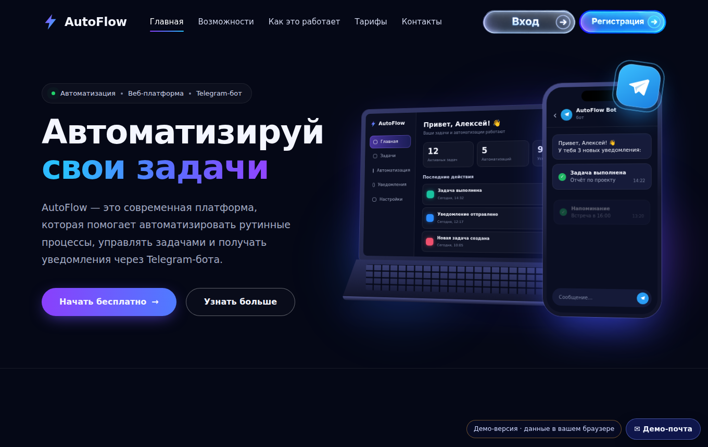
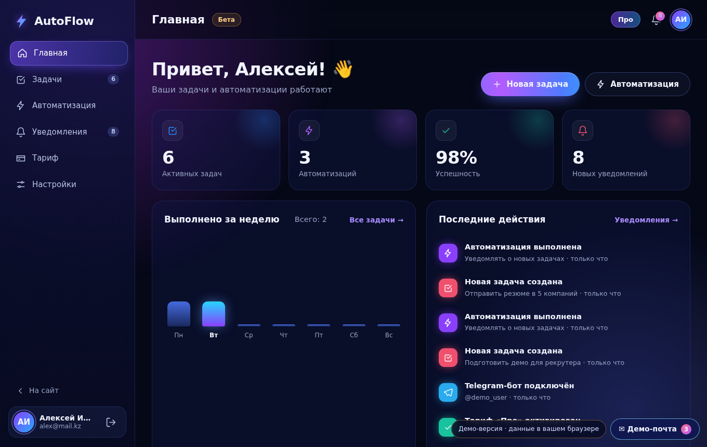
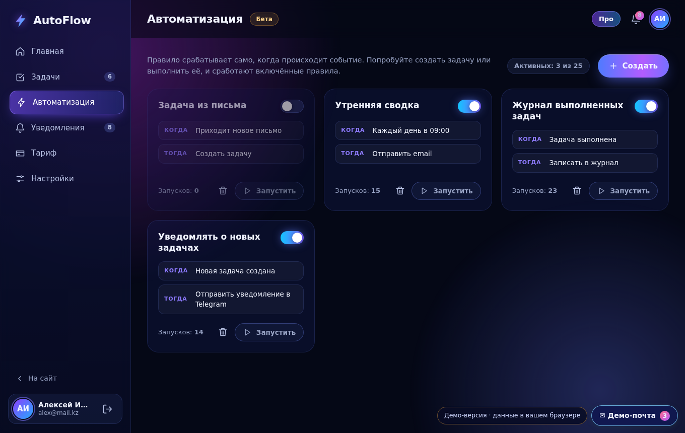
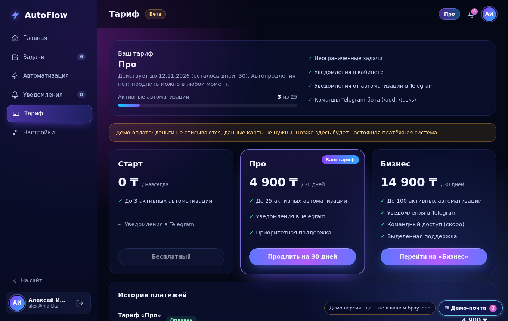
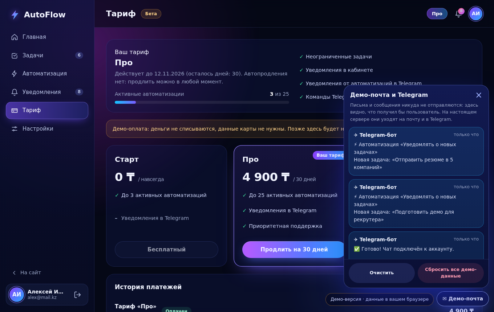

# AutoFlow

Платформа автоматизации задач с личным кабинетом, Telegram-ботом и тарифами. Полноценное веб-приложение **без фреймворков и внешних зависимостей**: Node.js 22, SQLite, чистые HTML/CSS/JS.

**[Открыть живое демо](https://velickindavid6-bit.github.io/Autoflow/)** · 96 автотестов · код сервера и тесты ниже

> Живое демо работает без сервера: на GitHub Pages можно выкладывать только статические файлы, поэтому «сервер» там работает прямо в браузере и повторяет логику настоящего (совпадение проверяют автотесты). Данные остаются в вашем браузере, письма и сообщения Telegram видны в окне «Демо-почта». Настоящий сервер находится в этом репозитории.



| Кабинет | Автоматизации |
|---|---|
|  |  |
| **Тарифы и оплата (демо)** | **Демо-почта и Telegram** |
|  |  |

## Что умеет

- **Аккаунты:** регистрация, вход, выход, профиль, смена пароля, удаление аккаунта вместе со всеми данными.
- **Подтверждение email и сброс пароля:** одноразовые ссылки, письма через SMTP или Resend.
- **Кабинет:** задачи, автоматизации с правилами «событие → действие», уведомления, журнал, график недели.
- **Telegram-бот:** привязка по одноразовой ссылке с подтверждением, команды `/tasks`, `/add`, кнопка ✅ под задачами, уведомления от автоматизаций.
- **Тарифы:** три тарифа с ограничениями на сервере; оформление заказа и страница оплаты (заглушка, к которой подключается настоящая платёжная система).
- **Форма обратной связи** с защитой от ботов.

## Безопасность (и чем это подтверждено)

| Что | Как сделано | Проверка |
|---|---|---|
| Пароли | хеш scrypt, в базе нет паролей | тесты входа |
| Сессии | случайный токен в HttpOnly-cookie, срок жизни, завершение при смене пароля | тесты сессий |
| Подделка запросов | проверка Origin + CSRF-токен на всех изменяющих запросах | тесты 403 |
| Чужие данные | владелец берётся только из сессии, чужая запись = 404, подмена владельца в теле игнорируется | перебор номеров записей в тестах |
| Перебор паролей | блокировка по email и IP, лимиты на письма, заказы и записи | тесты 429 |
| Ссылки из писем | токен только в виде хеша, одноразовые, во фрагменте URL (не попадает в логи), адрес берётся из настроек, а не из Host | тесты токенов |
| Цены и оплата | сумма и тариф фиксируются на сервере, заказ атомарно оплачивается один раз, чужой заказ недоступен | тесты гонок и подмены |
| Telegram | токен не попадает в логи, привязка только после подтверждения «Да», бот игнорирует группы | тесты с поддельным Telegram |
| Браузер | строгая CSP, X-Frame-Options, Referrer-Policy и др.; нет inline-скриптов | проверка заголовков |
| Закрытые файлы | исходники, база, `.env` недоступны по HTTP, обход `..` не работает | проверка живого сервера |

## Архитектура

```
Браузер (HTML/CSS/JS без фреймворков)
   │  fetch /api/*
   ▼
server.js (Node 22, без зависимостей)
 ├─ src/app.js        маршруты, CSRF, лимиты, заголовки безопасности
 ├─ src/auth.js       сессии, scrypt, одноразовые токены
 ├─ src/data.js       задачи, автоматизации, движок правил, лимиты тарифов
 ├─ src/billing.js    заказы, идемпотентное применение оплаты
 ├─ src/telegram.js   бот (long polling), очередь исходящих сообщений
 ├─ src/mailer.js     собственный SMTP-клиент (TLS) и Resend
 └─ SQLite (node:sqlite), миграции в src/db.js
```

**Демо-версия.** `demo/engine.js` повторяет логику сервера в браузере (правила и цены берутся из тех же файлов, что и на сервере). Тест `test/demo-parity.test.js` прогоняет один сценарий из 130+ запросов по настоящему серверу и по демо и сравнивает ответы. Я проверил сам тест: намеренная поломка демо ловится.

## Запуск

Нужен **Node.js 22.5+**. Устанавливать пакеты не нужно.

```bash
npm start            # сервер на http://127.0.0.1:3000
npm test             # 96 автотестов
npm run build:demo   # пересобрать демо-версию (папка docs/)
```

Настройки (почта, Telegram-бот, оплата) задаются в файле `.env`, пример в `.env.example`. Подробности: [guide/CONFIG.md](guide/CONFIG.md). Выкладка на GitHub Pages и на сервер: [guide/DEPLOY.md](guide/DEPLOY.md).

## Что не сделано (честно)

- Оплата работает как заглушка: деньги не списываются. Реальная платёжная система требует ИП/ТОО и подключается в одном месте (`src/billing.js`).
- Триггеры «Каждый день в 09:00» и «Приходит новое письмо» выбираются, но пока не срабатывают (нужны планировщик и интеграция с почтой). Действие «Отправить email» создаёт только уведомление в кабинете.
- «Командный доступ» в тарифе «Бизнес» помечен «скоро».
- Один процесс сервера и SQLite: для большой нагрузки понадобятся другая база и несколько экземпляров.
- Тексты «Условий» и «Политики» это шаблоны, их нужно заполнить и согласовать с юристом.

## Лицензия

MIT, см. [LICENSE](LICENSE).
